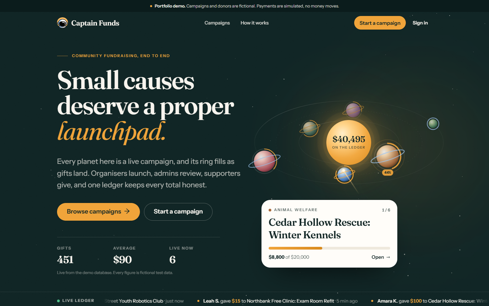
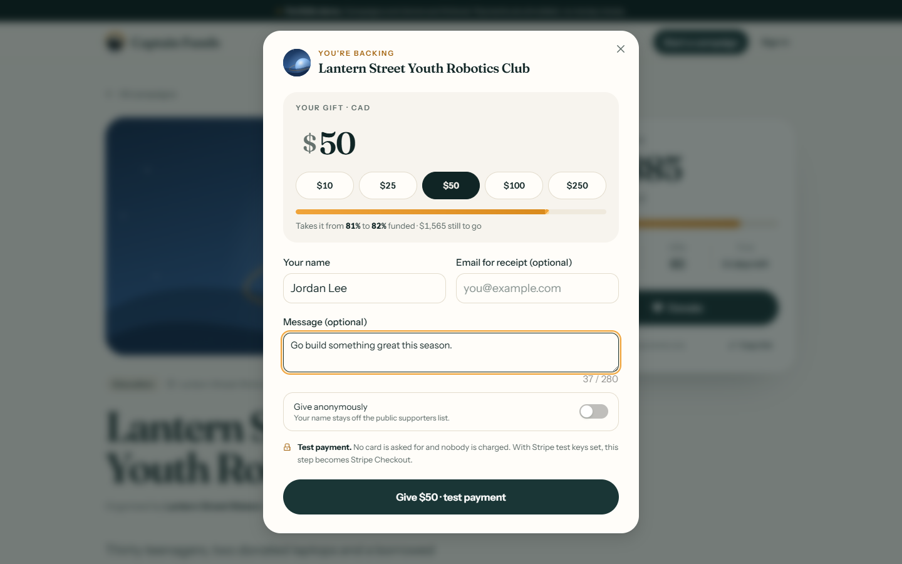
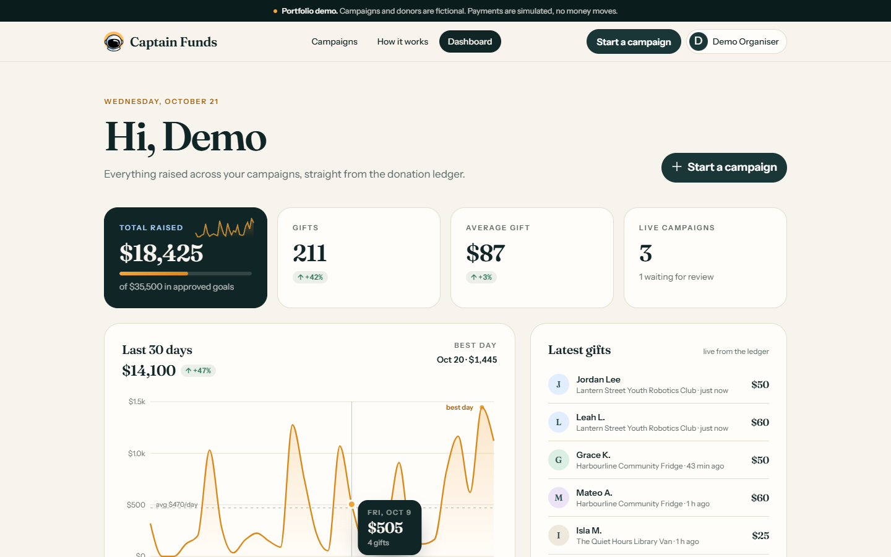
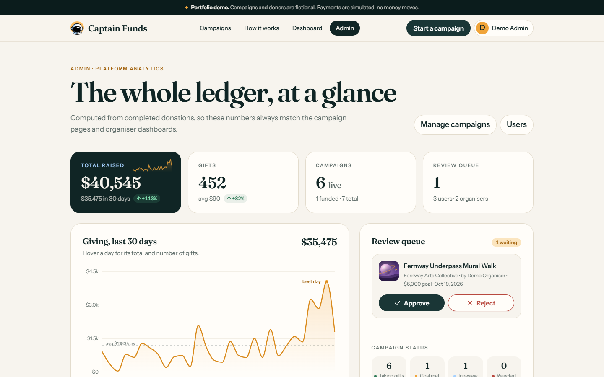
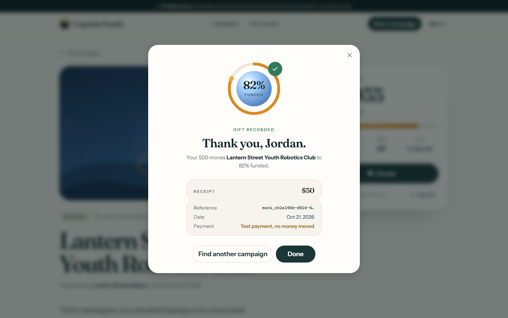
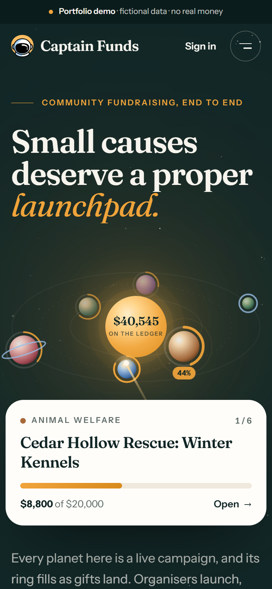

# Captain Funds

A community fundraising platform built on the MERN stack. Organisers start campaigns, admins review them, supporters give, and every total (campaign page, organiser dashboard, admin analytics) is read from one donation ledger.

This is a portfolio project. **All campaigns, organisers and donors are fictional, and no real money moves**: donations are either clearly labelled mock payments or Stripe Checkout in test mode.

| Landing | Campaign + donation |
|---|---|
|  |  |
| **Organiser dashboard** | **Admin analytics** |
|  |  |
| **Gift recorded** | **Phone (390 px)** |
|  |  |

More in [`revamp-shots/`](revamp-shots/): browse, campaign page, sign-in, 404 and the phone campaign page.

On the landing page every live campaign is a planet orbiting the ledger total (ring = how far it is funded, size = goal), and the latest gifts replay as comets falling from their campaign into the ledger. All motion switches off under `prefers-reduced-motion`.

## What you can do

**Without an account**
- Read the landing page with live platform totals
- Browse, search, filter by category and sort campaigns
- Open a campaign and donate as a guest (name optional, anonymous option)

**As an organiser** (any signed-in user)
- Start a campaign; it goes into an admin review queue and is private until approved
- Dashboard: total raised, number of gifts, average gift, 30-day chart, latest gifts, each campaign's status and progress
- See your own giving history

**As an admin**
- Analytics: raised (all time and last 30 days), donations, live/funded campaigns, giving per day, raised by category, money by payment source, top campaigns, latest donations
- Approve or reject (with a reason) from the review queue; feature, edit or delete campaigns
- Manage users: activate/deactivate, delete; see campaigns and giving per user

Raised totals cannot be edited by anyone. They only change when a donation completes.

## Quick start (no setup, no keys)

Requires Node 20.19+ (tested on Node 24).

```bash
# terminal 1: API on http://localhost:4100
cd server
npm install
npm run dev

# terminal 2: web app on http://localhost:4150
cd client
npm install
npm run dev
```

Open http://localhost:4150.

With no `MONGODB_URL`, the API starts an **in-memory MongoDB** ([mongodb-memory-server](https://github.com/typegoose/mongodb-memory-server)) and seeds the fictional demo data on every start. Data resets when the API restarts. The first run downloads the MongoDB server binary once (about a 600 MB download, about 60 MB unpacked, cached in `server/node_modules/.cache`).

### Demo accounts

Seeded into the in-memory database (or a real one with `SEED_DEMO=true`). The sign-in page also has one-click buttons for both.

| Role | Email | Password |
|---|---|---|
| Organiser | `demo@captainfunds.app` | `demo123` |
| Admin | `admin@captainfunds.app` | `admin123` |

These are public demo credentials. The server refuses to seed them when `NODE_ENV=production` unless `ALLOW_DEMO_SEED=true`.

### Browser-only demo (what Netlify serves)

```bash
cd client
npm run dev:demo      # or: npm run build:demo
```

`VITE_DEMO_MODE=true` swaps the HTTP API for an in-browser store (`client/src/lib/demoStore.ts`) seeded from the same fictional dataset (`shared/demo-seed.js`) and enforcing the same rules: pending campaigns stay private, only admins approve, totals come from the ledger. Data lives in that browser's `localStorage`. Payments are always mock in this mode. `netlify.toml` already builds this way.

## Payments

| Mode | When | What happens |
|---|---|---|
| Mock | `STRIPE_SECRET_KEY` empty (default) | The gift is recorded at once as `paymentProvider: "mock"`, with a `mock_…` receipt id. The UI says "Test payment, no money moved" before and after. No card details are asked for. |
| Stripe test mode | `STRIPE_SECRET_KEY=sk_test_…` | A pending donation and a Stripe Checkout Session are created; the donor pays on Stripe's page with test card `4242 4242 4242 4242`. The donation completes from the webhook or from the return-trip verify call, whichever lands first (idempotent). |

Live keys (`sk_live_…`) are refused at startup. To try Stripe locally:

```bash
# server/.env
STRIPE_SECRET_KEY=sk_test_...
# then, with the Stripe CLI:
stripe listen --forward-to localhost:4100/api/donations/webhook
# copy the printed whsec_... into STRIPE_WEBHOOK_SECRET and restart the API
```

Without the webhook, donations still complete when Stripe redirects back to the campaign page.

## Using a real MongoDB

```bash
# server/.env
MONGODB_URL=mongodb+srv://...
npm run seed            # load the fictional demo data (skips if campaigns exist)
npm run seed -- --reset # wipe campaigns + donations, then seed
npm run recount         # rebuild campaign totals from the donation ledger
```

All settings are documented in [`server/env.example`](server/env.example) and [`client/env.example`](client/env.example). Never commit `.env` files (they are git-ignored).

## Tests

```bash
cd server && npm test           # 29 API tests (node:test + supertest, in-memory MongoDB on port 4191)
cd client && npm run typecheck && npm run lint
cd client && npm run test:e2e       # Playwright: API (4120) + production build (4160)
cd client && npm run test:e2e:demo  # Playwright against the browser-only demo build (4161)
```

The API tests cover auth and roles (registration can't create admins, deactivated tokens stop working, admin-only routes), validation at every boundary, the review workflow, mock donations, Stripe test-mode checkout/verify/webhook with a fake Stripe client, and the full loop: create, approve, donate, then organiser totals, admin analytics and the ledger all agree.

The Playwright smoke test walks the public flow (land, browse, search, open a campaign, donate, see the total move) and the cross-role loop (organiser submits, admin approves from the queue, a guest gives, the organiser's total updates). Playwright needs its Chromium once: `npx playwright install chromium`.

## How it is built

```
client/   React 18 + TypeScript, Vite, Ant Design 5, Tailwind 4, Recharts, Socket.IO client
  src/lib/api.ts        one API surface; HTTP backend or the browser-only demo store
  src/lib/demoStore.ts  in-browser implementation of the API for the static demo
  src/pages/            landing, campaigns (browse/detail/new), dashboard, admin, ...
  e2e/                  Playwright smoke tests
server/   Express 5, Mongoose 8, zod, JWT, Stripe, Socket.IO
  routes/               users, campaigns, donations, admin, admin/campaigns, upload, simulation
  services/             donation ledger, payments (mock/Stripe), analytics
  seed/ scripts/        demo seeding, recount
  test/                 API tests
shared/   demo-seed.js: the fictional dataset used by both the seeder and the browser demo
```

Main endpoints:

| Method | Path | Access |
|---|---|---|
| GET | `/api/campaigns?q&category&sort` | public |
| GET | `/api/campaigns/stats` | public |
| GET | `/api/campaigns/:id` | public if approved; owner/admin otherwise |
| POST | `/api/campaigns` | signed in (pending review; admins publish directly) |
| GET | `/api/campaigns/mine` | signed in (organiser dashboard) |
| POST | `/api/donations/checkout` | public (guest or signed in), rate limited |
| GET | `/api/donations/verify/:sessionId` | public (Stripe return trip) |
| POST | `/api/donations/webhook` | Stripe signature required |
| GET | `/api/donations/mine` | signed in |
| GET | `/api/admin/analytics`, `/api/admin/donations` | admin |
| GET/POST/PUT/DELETE/PATCH | `/api/admin/campaigns[...]` | admin |
| POST | `/api/users/register`, `/api/users/login` | public, rate limited |
| GET/PUT | `/api/users/me`, `/api/users/profile` | signed in |
| GET/PATCH/DELETE | `/api/users[/:id]` | admin (or self for read/update) |
| GET | `/api/config`, `/api/health` | public |

Security notes:
- Every request body and query is parsed with zod (unknown fields dropped, money as whole dollars, https-only image URLs); bad ObjectIds return 404, not a crash.
- JWT (Bearer header) is verified and the user's role and active flag are re-read from the database on every request, so demotions and deactivations apply immediately.
- New accounts can never set `isAdmin`; raised totals and approval flags can't be set from client input.
- Socket.IO rooms for personal and admin events are joined from a verified token, never on the client's word; clients cannot broadcast.
- Public donation lists never include donor emails; anonymous gifts hide the name everywhere public.

## What needs real keys or a decision

| Item | Needed for | Where |
|---|---|---|
| Stripe **test** secret key + webhook secret | Stripe Checkout instead of mock payments | `STRIPE_SECRET_KEY`, `STRIPE_WEBHOOK_SECRET` |
| MongoDB connection string (e.g. Atlas) | Persistent data / any hosted API | `MONGODB_URL` |
| A long random `JWT_SECRET` | Required in production | `JWT_SECRET` |
| Cloudinary keys (optional) | Image upload endpoint (`/api/upload/*`); the form currently takes an image URL | `CLOUDINARY_*` |
| SMTP credentials (optional) | Outgoing email; without them emails are logged and skipped | `EMAIL_*` |
| A host for the API | The Netlify site is the browser-only demo; a live API needs a Node host (Render, Railway, Fly, a VPS) | `VITE_API_URL` at build time |

## Known limitations

- Ledger completion and the campaign counter update are two writes without a transaction (the in-memory server is a standalone mongod). `npm run recount` rebuilds counters from the ledger.
- Rate limits are in-memory (per process); use a shared store behind a load balancer.
- The JWT is kept in `localStorage` (as the original app did); an httpOnly cookie + CSRF protection would be the next step.
- No refunds, recurring donations or receipts by email yet (the old UI had placeholders for these; they were removed rather than faked).
- `vercel.json` and `VERCEL-DEPLOYMENT.md` predate this revamp and are untested; the docs in `docs/` describe the earlier state of the project.

## Ports

API 4100 (in-memory MongoDB on a random port, or `MONGO_MEMORY_PORT`), web 4150, preview 4173. Tests use 4120/4160/4161 and MongoDB 4191/4192.

## License

MIT.

Built by Solomon Olufelo.
